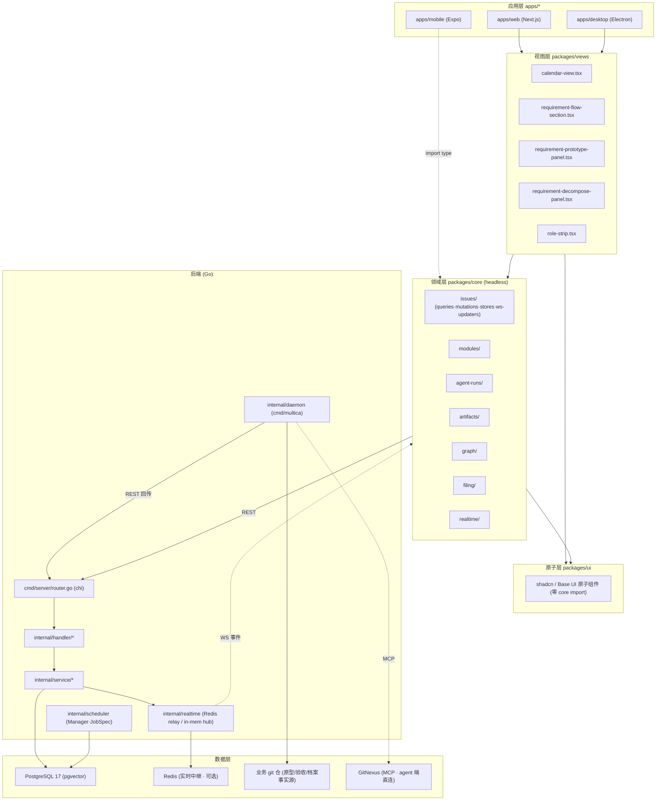
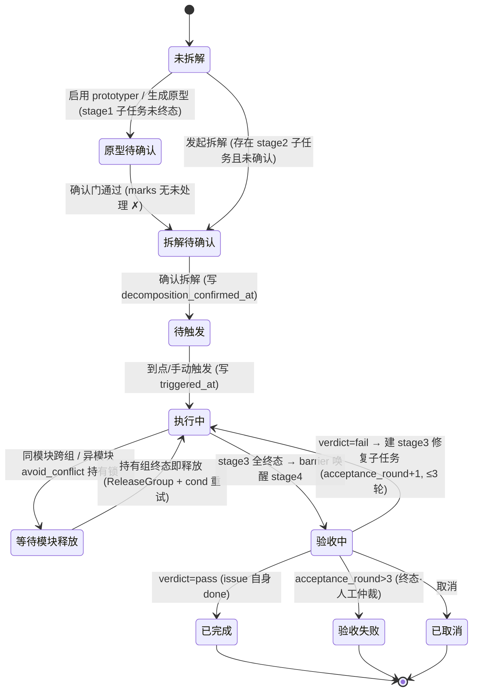
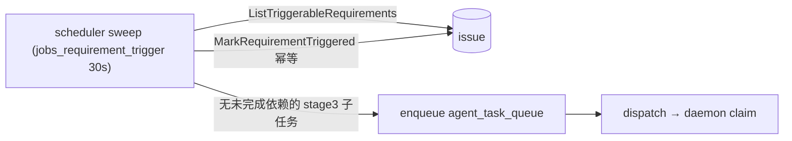
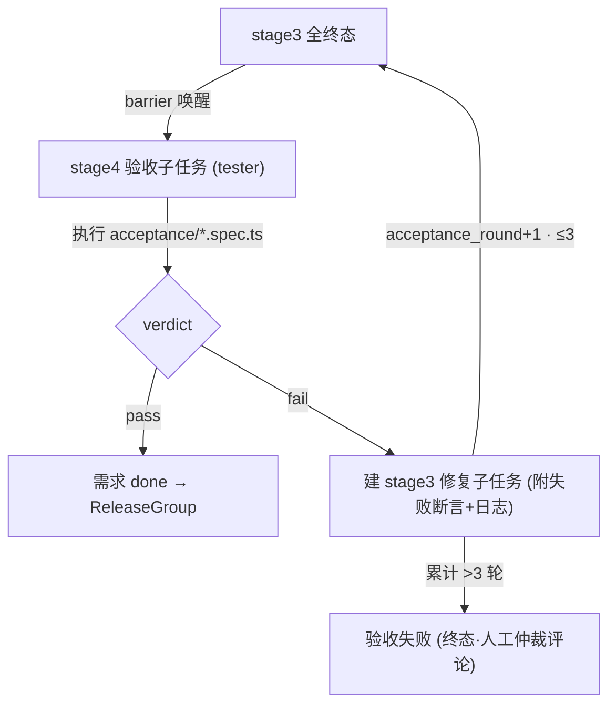
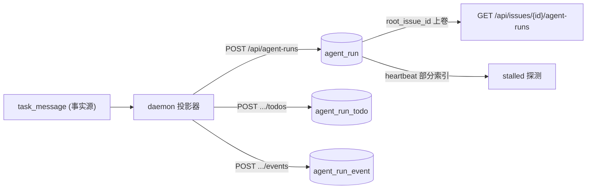
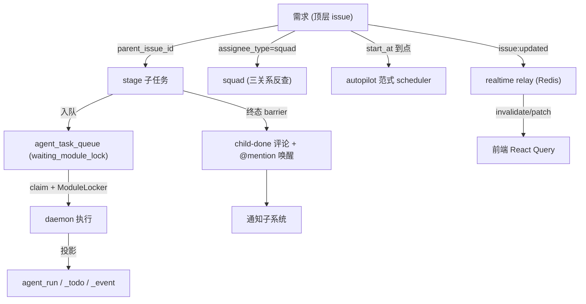

# Multica 产品架构 · 需求日历与角色化流水线

> 系统级产品架构文档。以仓库真实代码与 `server/migrations/451–460` 为唯一事实源；
> 设计意图（尚未落地的机制）在文中显式标注为 **[设计]**，与 **[已交付]** 区分。
> 配套数据模型见 `docs/superpowers/specs/2026-09-06-requirement-calendar-er.md`，
> 图集见 `docs/superpowers/specs/2026-09-04-requirement-calendar-architecture.html`。

需求日历（requirement calendar）把「需求」从一条普通 issue 升级为带
**目标 / git 库 / 分钟粒度时间窗口 / 五角色班底 / 四阶段流水线** 的一等公民，
并复用既有的 stage barrier、依赖 DAG、模块互斥锁、autopilot 调度器等机制——
**只做编排，不发明新机制**。

---

## 1. 分层架构（monorepo 包边界 + 后端拓扑）

前端为 pnpm + turbo monorepo，三端复用同一套 headless 业务逻辑；后端为 Go
单点编排（server）+ 分布式执行（daemon）+ 调度器（scheduler）+ Redis 实时中继 +
PostgreSQL 17（`pgvector/pgvector:pg17` 镜像）。

### 1.1 包边界（hard rules，源自 `AGENTS.md` / `CLAUDE.md`）

| 层 | 目录 | 职责 | 硬约束 |
| --- | --- | --- | --- |
| 应用层 | `apps/web` · `apps/desktop` · `apps/mobile` · `apps/docs` | 平台壳（Next.js / Electron / Expo / Fumadocs） | Next.js API 只允许出现在 `apps/web/platform/`；`react-router-dom` 只允许出现在 `apps/desktop/.../platform/`；mobile 独立，仅可 `import type` 复用 core |
| 视图层 | `packages/views/` | 共享业务页面/组件 | **禁** `next/*`、**禁** `react-router-dom`、**禁** stores；路由统一走 `NavigationAdapter` / `useNavigation()` / `<AppLink>` |
| 领域层 | `packages/core/` | headless 业务逻辑：Zustand stores + React Query hooks + API client | **禁** `react-dom`、**禁** `localStorage`（用 `StorageAdapter`）、**禁** `process.env`、**禁** UI 库；所有 Zustand store 只能落在此层 |
| 原子层 | `packages/ui/` | shadcn / Base UI 原子组件，零业务逻辑 | **禁** `import @multica/core` |
| 配置层 | `packages/tsconfig/` · `packages/eslint-config/` · `packages/plugin-sdk/` | 共享 TS / ESLint 配置、插件 SDK | — |

**状态管理铁律**：React Query 拥有全部服务端状态（issues / members / agents / inbox /
workspace）；Zustand 只拥有客户端/视图状态（view filters、drafts、modals、desktop tab）。
WS 事件只 invalidate/patch Query 缓存，**绝不**把服务端 payload 镜像进 Zustand。

### 1.2 分层图

### 1.3 后端拓扑

- **server**（`cmd/server/router.go`，chi 路由）：单点编排，Postgres 为事实源。
  handler（HTTP 边界）→ service（领域逻辑 + 事务）→ `pkg/db/generated`（sqlc）。
- **daemon**（`cmd/multica`，`internal/daemon/daemon.go`）：每 agent 一份，分布式执行。
  持有 `ModuleLocker`、`LocalPathLocker`，claim 任务、跑 runtime、回传状态与 agent_run 投影。
- **scheduler**（`internal/scheduler/manager.go`）：进程内 `Manager` + `Register(JobSpec)`，
  job 审计写 `sys_cron_executions`。既有 `jobs_autopilot.go` 是到点触发的范式模板。
- **Redis**：`internal/realtime` 的可选中继后端（多实例广播）；单实例默认走内存 hub。
- **PostgreSQL 17 + pgvector**：pgvector 扩展在 DB 级启用（供记忆/embedding 召回子系统使用）；
  **需求日历的本体层（migration 457）刻意「降级先行」——先建表不带 embedding/vector 列**，
  本体抽取就绪后再接管。

---

## 2. 需求日历四阶段流水线

阶段编号 1-based，落在 `issue.stage`（migration **123**，`CHECK (stage IS NULL OR stage >= 1)`）。
`stage` 只在「同一 `parent_issue_id` 下的兄弟集合」内有意义；顶层 issue 上的 stage 为 inert。

| stage | 名称 | 主责角色 | 关键产出 | 落库 |
| --- | --- | --- | --- | --- |
| 1 | 原型 **[可选]** | prototyper | HTML 原型（`docs/prototypes/*.html`）+ 逐项 ✓/✗/○ 标记 | `issue_prototype_version`（454）：`html_path`·`prompt`·`marks`·`status(pending→confirmed/superseded)` |
| 2 | plan + 拆解 | pm | plan 评论 + 功能点/验收点/依赖/执行人草稿 → confirm/auto 生效 | 批量建 stage 3/4 子 issue：`parent_issue_id`·`stage`·`feature_points`·`graph_context`·`acceptance_spec`；写 `decomposition_confirmed_at` |
| 3 | 执行 | developer（多 agent 并行）· data | 代码 + 交付物 | `triggered_at`；子任务入 `agent_task_queue` |
| 4 | 验收 | tester（停用回落 pm） | 验收报告评论 + verdict | `acceptance_round`（452，见 §5.3 **[已交付]** 说明） |

### 2.1 stage barrier（migration 123 · [已交付]）

`internal/handler/issue_child_done.go`（`stageBarrierClosed`）：子任务终态时，
仅当「最低未完成 stage 内的全部兄弟都到达终态（done/cancelled）」这一 barrier 闭合，
才发父级 child-done 系统评论并唤醒父责任人（parent-assignee trigger）。
未分 stage 的兄弟集合视作单一隐式 stage——最后一个子任务完成时只唤醒一次。

### 2.2 流水线状态机

### 2.3 派生 `requirement_status`（`pkg/db/queries/issue.sql` ListIssues CASE · [已交付]）

**不落列**，查询时实时派生（与 `issue_effective_status` 同思路，永远与事实一致）。
`ListIssues` 用一个 `LEFT JOIN LATERAL`（别名 `prog`）聚合直接子任务的 stage 计数，
再按下列规则自上而下命中即返回（第 10 态「验收失败」由 WS4 落地，置于 stage 态之前）：

| 优先级 | 派生条件 | requirement_status |
| --- | --- | --- |
| 1 | `issue_effective_status(...) = 'done'` | 已完成 |
| 2 | `issue_effective_status(...) = 'cancelled'` | 已取消 |
| 3 | `acceptance_round > 3` | 验收失败 |
| 4 | `prog.has_open_stage1` | 原型待确认 |
| 5 | `decomposition_confirmed_at IS NULL AND prog.has_stage2` | 拆解待确认 |
| 6 | `decomposition_confirmed_at IS NULL` | 未拆解 |
| 7 | `triggered_at IS NULL` | 待触发 |
| 8 | 无 stage3 子任务在 `dispatched/running` **且** 有子任务 `waiting_module_lock` | 等待模块释放 |
| 9 | `prog.has_open_stage3` | 执行中 |
| 10 | `prog.has_open_stage4` | 验收中 |
| ELSE | 其余 | 已完成 |

> **10 个互异状态**：已完成 / 已取消 / 验收失败 / 原型待确认 / 拆解待确认 / 未拆解 /
> 待触发 / 等待模块释放 / 执行中 / 验收中。
> 第 10 态「验收失败」= `acceptance_round > 3`（累计 4 轮打回仍未过，WS4 落地，见 §5.3）。
> 规则 8（等待模块释放）带守卫：仅当没有任何 stage3 子任务在推进（`dispatched/running`）
> 且确有子任务泊在 `waiting_module_lock` 时才命中，避免执行中被误判为等待。
> `ListIssues` 另投影 `stage_progress`（stage 3 的 `done/total`，无 stage3 子任务时为空串）。
> 同一 CASE 在 `internal/handler/issue_archive.go`（`loadDeliverablesProjection`）有一份
> **逐字复制**，两处需保持同步（见 ER §3 备注）。

---

## 3. 五角色班底（roster）

角色枚举固定为 **pm / prototyper / developer / data / tester**（migration 453，两表同 CHECK）。
指派对象 `assignee_type ∈ {member, agent}`（+ `squad` 在 issue.assignee 层，见 §6）。

| 表 | migration | 语义 | 唯一键 |
| --- | --- | --- | --- |
| `project_role_default` | 453 | **项目默认班底**；developer 可多行 | `UNIQUE(project_id, role, assignee_type, assignee_id)` |
| `issue_role_assignment` | 453 | **需求级快照**；创建需求时从项目默认拷贝，之后项目默认变更不影响已建需求 | `UNIQUE(issue_id, role, assignee_type, assignee_id)` |

- 拷贝语句：`requirement.sql` 的 `CopyProjectRoleDefaultsToIssue`（`INSERT … SELECT FROM project_role_default`）。
- 两表均支持 whole-document replace：`Delete*` + `Insert*`（`jsonb_to_recordset`）必须同事务先后执行
  （不能合并为单语句 CTE——WITH 内数据修改语句与主查询共享快照，INSERT 看不到同语句 DELETE）。
- **pm / developer 为必选角色**（server 侧校验 `enabled`）。
- API：`GET|PUT /api/issues/{id}/roles`（`ListIssueRoleAssignments` / `ReplaceIssueRoleAssignments`）；
  项目默认经 `requirement_roles.go` 的 `ListProjectRoleDefaults` / `ReplaceProjectRoleDefaults`。

---

## 4. 模块 / 依赖调度（migration 451）

理念：**一个项目通常就是一个产品**——同一模块下的修改通过**显式依赖**串行编排，
跨模块的修改默认互不阻塞（勾选「避免冲突」后按模块互斥），取代目录级强制互斥。

| 实体 / 列 | migration | 说明 |
| --- | --- | --- |
| `project_module` | 451 | 项目下轻量单选枚举：`name`·`color(DEFAULT '#8A8F98')`·`UNIQUE(project_id,name)`；455 追加 `graph_node_id`（图谱桥接） |
| `issue.module_id` | 451 | 单选 FK → `project_module`，`ON DELETE SET NULL`；模块色 → 日历色块 |
| `issue.avoid_conflict` | 451 | `BOOLEAN NOT NULL DEFAULT false`，跨模块互斥开关 |
| `issue_dependency` | 001 建表 / 451 激活 | 451 加 `UNIQUE(issue_id,depends_on_issue_id)` + `CHECK(issue_id <> depends_on_issue_id)`；依赖统一写 `type='blocked_by'`（`blocks`/`related` 不在本期） |
| `agent_task_queue.status` | 451 | CHECK 追加 `waiting_module_lock`（既有：queued/dispatched/running/completed/failed/cancelled/waiting_local_directory/deferred） |

**同模块校验**：依赖边只允许在**同模块**内建立（跨模块依赖 server 侧 409 拒绝）。
API：`GET|PUT /api/issues/{id}/dependencies`；模块 CRUD `GET|POST|PATCH|DELETE /api/projects/{id}/modules`。

---

## 5. 五大运行时机制（架构视角 + 数据流）

### 5.1 到点触发 loop（scheduler）

- **[已交付 · 查询层]** `requirement.sql`：
  - `ListTriggerableRequirements`——命中部分索引 `idx_issue_trigger_sweep`，扫描
    `parent_issue_id IS NULL ∧ auto_trigger=true ∧ triggered_at IS NULL ∧
    decomposition_confirmed_at IS NOT NULL ∧ start_at IS NOT NULL ∧ start_at ≤ now() ∧
    issue_effective_status ∉ (done,cancelled)`，按 `start_at ASC`。
  - `MarkRequirementTriggered`——`UPDATE … SET triggered_at=now() WHERE id=$1 AND triggered_at IS NULL`，
    **幂等**：影响 0 行 = 已被并发触发，调用方跳过。
- **[已交付 · 调度层]**（WS2）独立的 `jobs_requirement_trigger.go`（镜像 `jobs_autopilot.go`：
  注册 `JobSpec`（`JobNameRequirementTrigger = "requirement_trigger_dispatch"`）到 `scheduler.Manager`、
  写 `sys_cron_executions` 审计、**30s sweep**）已落地——`RequirementTriggerJob` 每 30s 扫
  `ListTriggerableRequirements` 并派发；与手动 `POST /issues/{id}/trigger`（`requirement_trigger.go`）
  共用单入口 `triggerOneRequirement`（`TriggerRequirementNow`）。
- **改期语义**（`issue.go`）：`triggered_at` 非空后再改 `start_at` 被 **409** 拒绝——排期归运行中流水线所有。

### 5.2 ModuleLocker v2（daemon · migration 451 + WS3 · [已交付]）

`internal/daemon/module_locker.go`。**真实锁模型（v2，务必以此为准）**：

- 锁 **key = `(moduleID, rootID)`** 二维互斥，每个持有记
  `moduleHold{moduleID, moduleName, rootID, rootTitle, exclusive}`，`holders map[taskID]moduleHold`
  为单事实源。`rootID` = 任务组标识（`issue.root_requirement_id`，沿 `parent_issue_id` 取根，独立 issue 的 root=自身）。
- **同模块同组**（rootID 相同且非空）：**永不互斥**——组内并行子任务顺序由依赖 DAG 表达。
- **同模块跨组**：**无条件互斥**（不看 exclusive）——同模块的不同需求串行，`onWait` 注明持有方**需求标题**。
- **异模块**：维持 451 语义——任一方 `exclusive`（`avoid_conflict`）即互斥，`onWait` 注明持有方**模块名**。
- **任一方 rootID 为空**：同模块维度退化为 451（不互斥），异模块规则不变；`moduleID` 为空不参与。
- 判定与计入在同一临界区完成；不保证严格 FIFO（与 `LocalPathLocker` 一致）。`onWait` 锁外调用、至多一次。
- daemon 经 `/wait-module-lock` 端点写 `agent_task_queue.status='waiting_module_lock'` +
  `wait_reason`（同模块跨组＝`模块「X」 (held by 需求组「<title>」)`；异模块＝`模块「X」 (held by 模块「Y」)`）。
- **终态即释放**：root 到达终态（done/cancelled/failed）→ `ReleaseGroup(rootID)` 释放该组全部 hold
  + `cond.Broadcast()` 唤醒等待者（等待方靠 `Acquire` cond 重试 + 30s 轮询自足，见 design §7.3 v1 实现说明）。

### 5.3 验收 verdict 闭环

- **[已交付]** stage 4 验收子任务由 `requirement_decompose.go` 的 `buildAcceptanceBrief` 组装 description
  （依据 = 已确认原型 `html_path` + 各 stage3 子任务 `acceptance_spec` 汇总）；
  验收报告以 comment 形式回流；`acceptance` 阶段门 doc_type 见 §5.5 `stage_gate_rule`（S4：`acceptance`+`report`）。
- **[已交付]**（WS4）「verdict pass/fail → fail 建 stage3 修复子任务 → `acceptance_round +1` →
  累计 >3 轮转『验收失败』终态 + 人工仲裁」闭环已接线：`handler/requirement_acceptance.go`
  的 `RecordAcceptanceVerdict`（`POST /api/issues/{id}/acceptance/verdict`）——`pass` → 需求落 done
  （WS3 root 终态钩子随后 `ReleaseGroup`）；`fail` → `IncrementAcceptanceRound`（`requirement.sql`），
  `newRound > 3` 则不再建修复子任务、改发 `postAcceptanceFailedComment`（人工仲裁 system 评论），
  否则建 stage3 修复子任务并入队；`issue_child_done.go` barrier 负责 stage3→stage4 唤醒。
  派生态第 10 态「验收失败」= `acceptance_round > 3`（见 §2.3）。

### 5.4 agent_run 投影（migration 459 · [已交付]）

**会话流 `task_message` 是事实源；`agent_run` / `agent_run_todo` / `agent_run_event` 是单向投影**（只读派生，不回写业务）。

- daemon → server **三个写端点**（`cmd/server/router.go` `/api/agent-runs`）：
  - `POST /api/agent-runs`（`UpsertAgentRun`）——传 `id` 则幂等 upsert（`ON CONFLICT (id) DO UPDATE`），省略则 server 铸新 run。
  - `POST /api/agent-runs/{runId}/todos`（`UpsertAgentRunTodos`）——批量 todo，`UNIQUE(run_id, todo_key)`，`superseded_by` 串血缘。
  - `POST /api/agent-runs/{runId}/events`（`AppendAgentRunEvents`）——追加事件流。
- 读端点：`GET /api/agent-runs/{runId}/todos|events`；issue 级聚合 `GET /api/issues/{id}/agent-runs`（`ListAgentRuns`）；
  workspace 级 `GET /api/agent-run-counts`；dashboard `GET /api/agent-runtime`。
- `agent_run.root_issue_id`（FK issue SET NULL）→ 需求维度的 run 汇总（`listAgentRunsForIssue` 经 root 上卷）。
- `status ∈ running/completed/failed/cancelled/stalled`；`stall_reason ∈ rate_limited/network_lost/crashed/waiting_module_lock/waiting_local_directory`；
  `last_heartbeat_at` + 部分索引 `idx_agent_run_heartbeat (WHERE status='running')` 支撑 stalled 探测。

### 5.5 依赖 DAG 闸门 + 阶段门（stage_gate_rule · migration 460）

- **依赖 DAG 闸门**：claim 时校验 `issue_dependency`（`blocked_by`）——存在未完成前置则不放行；
  同模块顺序完全由 DAG 表达（配合 §5.2「同模块不锁」）。
- **阶段门规则 `stage_gate_rule`（460 · [已交付]）**：补齐「每个 stage 要求哪些 `doc_type` 齐备」的规则载体
  （此前 `project_artifact.stage`(455) + `doc_type` 只能证明「档案架为空」，无法断言「缺哪份文档 / 门是否闭合」）。
  - 规则来源优先级：**project 级**（`project_id` 非空）覆盖 **workspace 级默认**（`project_id` NULL）；
    `track` 区分申报/交付轨道，交付门走 `track IS NULL` 默认轨道。
  - `blocking=true` 的规则项计入「档案完整度环」并参与门闭合判定。
  - `UNIQUE INDEX uq_stage_gate_rule_scope`：`(workspace_id, COALESCE(project_id,zero-uuid), COALESCE(track,''), stage, required_doc_type)`
    ——唯一键补入 `workspace_id` 使 per-workspace 种子可落地（否则多 workspace 的 `project_id=NULL` 默认行会互相冲突）。
  - **种子（每 workspace 8 行，7 项 blocking）**：S1 `prototype`｜S2 `plan`+`decomposition`｜
    S3 `design`+`test-plan`+`deliverables(blocking=false)`｜S4 `acceptance`+`report`。doc_type 全部取自原型档案行，未凭空发明。

---

## 6. 跨模块联动映射（审计重点）

需求日历不是孤岛——它以 `issue` 为轴，与既有 6 大子系统双向联动：

| 联动对象 | 方向 | 联动关系 | 代码锚点 |
| --- | --- | --- | --- |
| **issue** | 核心轴 | 需求 = 顶层 issue（`parent_issue_id IS NULL`）；子任务 = 带 `stage` 的子 issue；`root_requirement_id` 归组 | `issue.sql` ListIssues / `service/issue.go` / `service/requirement_decompose.go` |
| **agent_task_queue** | 执行队列 | stage3 子任务入队；`status` 含 `waiting_module_lock`（451）；`wait_reason` 上报模块占用；claim 受依赖 DAG + agent 并发闸门约束 | `queries/agent.sql` / `daemon.go` |
| **squad** | 指派对象 | `issue.assignee_type` 可为 `squad`；`ListIssues` 的 `involves_user_id` 经 squad 三关系（成员 / leader agent / squad 内 agent）反查间接指派 | `issue.sql`（involves_user_id 分支）/ `handler/squad_*` |
| **autopilot** | 调度范式 | 到点触发 loop 镜像 `jobs_autopilot.go`（JobSpec + `sys_cron_executions`）；WS2 已落地独立 `jobs_requirement_trigger.go`（30s sweep）+ 手动 `POST /issues/{id}/trigger` | `scheduler/jobs_requirement_trigger.go` / `handler/requirement_trigger.go` / `scheduler/jobs_autopilot.go` |
| **WS 实时** | 状态推送 | issue 变更经 `internal/realtime`（Redis relay / 内存 hub）广播 `issue:updated` 等事件 → 前端 `core/issues/ws-updaters.ts` invalidate/patch React Query（**不镜像进 Zustand**） | `internal/realtime/*` / `core/issues/ws-updaters.ts` |
| **通知** | 唤醒/播报 | stage barrier 闭合 → 父责任人 child-done 系统评论 + @mention 唤醒；`plugin_event_dispatch` 从 `issue:updated` 派生 `issue.status_changed` | `handler/issue_child_done.go` / `service/plugin_event_dispatch*` |

---

## 7. 关键 API 面（`cmd/server/router.go`）

| 分组 | 端点 | handler |
| --- | --- | --- |
| **requirement / decompose** | `POST /api/issues/{id}/decompose` · `GET /api/issues/{id}/decomposition` · `POST /api/issues/{id}/decomposition/confirm` | `DecomposeRequirement` · `GetDecomposition` · `ConfirmDecomposition` |
| **roles（班底）** | `GET|PUT /api/issues/{id}/roles` | `ListIssueRoleAssignments` · `ReplaceIssueRoleAssignments` |
| **prototype（原型）** | `POST /api/issues/{id}/prototype/generate` · `GET /api/issues/{id}/prototypes` · `POST /api/issues/{id}/prototypes/{version}/marks` · `POST .../prototypes/{version}/confirm` | `GeneratePrototype` · `ListPrototypeVersions` · `UpdatePrototypeMarks` · `ConfirmPrototype` |
| **trigger（触发）** | `POST /api/issues/{id}/trigger`（WS2 手动触发） · `POST /api/issues/preview-trigger` · `POST /api/issues/{id}/comments/trigger-preview` | `TriggerRequirement` · `PreviewIssueTrigger` · `PreviewCommentTriggers` |
| **modules / dependencies** | `GET|POST /api/projects/{id}/modules` · `PATCH|DELETE .../modules/{moduleId}` · `GET|PUT /api/issues/{id}/dependencies` | `ListProjectModules` 等 · `GetIssueDependencies` · `PutIssueDependencies` |
| **artifacts（档案）** | `POST /api/projects/{id}/artifacts/sync` · `GET .../artifacts/matrix` · `GET .../artifacts/unbound` · `GET .../artifacts` · `GET|PATCH .../artifacts/{artifactId}` · `GET .../artifacts/{artifactId}/content` · `POST .../artifacts/{artifactId}/archive|bind` | `SyncProjectArtifacts` · `GetArtifactMatrix` · `ArchiveDeliverable` · `BindProjectArtifact` 等 |
| **graph（图谱）** | `POST /api/projects/{id}/graph/sync` · `GET .../graph/latest` · `.../graph/latest/detail` · `.../graph/modules` · `.../graph/modules/{nodeId}/changes|objects|strategies|neighborhood` · `.../graph/bus-matrix` · `.../bus-matrix/drilldown|alerts|timeline` | `SyncGraphSnapshot` · `GetLatestGraphSnapshot` · `ListGraphModules` · `GetBusMatrix` 等 |
| **filing（申报就绪度）** | `GET /api/projects/{id}/filing/readiness` · `.../filing/items` · `PATCH .../filing/items/{itemId}` · `.../filing/cross-project` · `POST .../filing/check` · `.../filing/export` · `.../filing/writeback` | `GetFilingReadiness` · `ListFilingItems` · `RunFilingCheck` · `ExportFilingPackage` · `WritebackFilingReadiness` |
| **agent-run（运行投影）** | `POST /api/agent-runs` · `GET|POST /api/agent-runs/{runId}/todos` · `GET|POST .../agent-runs/{runId}/events` · `GET /api/issues/{id}/agent-runs` · `GET /api/issues/{id}/dynamics|deliverables-overview|progress` · `GET /api/agent-run-counts` · `GET /api/agent-runtime` | `UpsertAgentRun` · `UpsertAgentRunTodos` · `AppendAgentRunEvents` · `ListAgentRuns` · `GetIssueDynamics` 等 |
| **acceptance / stage-gate** | `POST /api/issues/{id}/acceptance/verdict`（WS4 verdict pass/fail）；阶段门规则载体 = `stage_gate_rule`（460），经 artifacts/matrix + filing/readiness 暴露门闭合与完整度环 | `RecordAcceptanceVerdict` · `GetArtifactMatrix` · `GetFilingReadiness` |

---

## 8. 与设计文档的偏差登记（以代码为准）

| # | 设计表述 | 落地真相 | 状态 |
| --- | --- | --- | --- |
| 1 | ModuleLocker v2 锁 key = `(module_id, root_requirement_id)`，同模块跨组互斥 | **已落地（WS3）**：锁 key = `(moduleID, rootID)`；同模块同组不互斥、**同模块跨组无条件互斥**、异模块维持 `avoid_conflict` 语义；`ReleaseGroup(rootID)` 整组释放 | 已落地 |
| 2 | `requirement_status` 10 态含新增「验收失败」 | **已落地（WS4）**：`issue.sql` CASE 实为 **10 个互异状态**，第 10 态 `acceptance_round > 3 → 验收失败`；规则8（等待模块释放）带 `NOT EXISTS(dispatched/running)` 守卫 | 已落地 |
| 3 | scheduler `jobs_requirement_trigger.go` 30s sweep | **已落地（WS2）**：`jobs_requirement_trigger.go`（`RequirementTriggerJob`，30s sweep，`JobNameRequirementTrigger`）+ 手动 `POST /issues/{id}/trigger` 共用 `triggerOneRequirement` | 已落地 |
| 4 | 验收 verdict 闭环（3 轮上限 → 验收失败终态） | **已落地（WS4）**：`requirement_acceptance.go` verdict pass/fail + `IncrementAcceptanceRound`（>3 转验收失败终态 + 人工仲裁）+ `issue_child_done.go` barrier | 已落地 |
| 5 | migration 457 `ontology_entity/relation/embedding` | 实为 `ontology_object` / `ontology_link` / `ontology_changelog`，**无 embedding 表/列**（降级先行） | 纠偏 |
| 6 | migration 458 `filing_index/status/coverage` | 实为 `filing_item` / `filing_check_run` / `filing_export_log`；`filing_item.source_path` 为**死列**（从不写入） | 纠偏 |
| 7 | issue 需求字段「+13 列」（452） | 452 实加 **12 列**（`start_at`·`goal`·`repo_resource_id`·`decompose_mode`·`auto_trigger`·`decomposition_confirmed_at`·`triggered_at`·`acceptance_round`·`root_requirement_id`·`feature_points`·`graph_context`·`acceptance_spec`）+ root 递归回填 + 3 索引 | 纠偏 |
