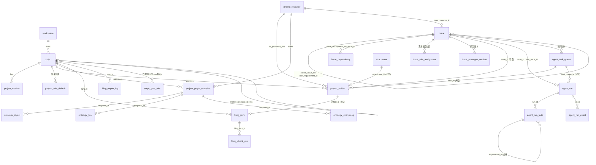

# 需求日历数据模型 ER（migrations 451–460）

> 事实源：`server/migrations/451_*` … `460_*.up.sql`（逐个核实真实列/类型/约束/默认值）+
> `server/pkg/db/queries/{issue,requirement,agent,module}.sql`。
> 配套系统架构见根目录 `ARCHITECTURE.md`；图集见同目录 `2026-09-04-requirement-calendar-architecture.html`。
> 标注约定：**[派生]** = 不落列，查询时计算；**[死列]** = 建了但代码从不写入；**[注入位]** = 预留 DEFAULT 空容器。

## 0. 实体清单

本 ER 覆盖 **20 个实体**：

- **新增/激活表（17）**：`project_module`(451) · `issue_dependency`(001建/451激活) · `project_role_default`(453) · `issue_role_assignment`(453) · `issue_prototype_version`(454) · `project_artifact`(455) · `project_graph_snapshot`(456) · `ontology_object`(457) · `ontology_link`(457) · `ontology_changelog`(457) · `filing_item`(458) · `filing_check_run`(458) · `filing_export_log`(458) · `agent_run`(459) · `agent_run_todo`(459) · `agent_run_event`(459) · `stage_gate_rule`(460)
- **扩展表（3）**：`issue`（451 +2 列 / 452 +12 列需求字段 + 触发字段）· `project`（455 +`archive_resource_id`）· `agent_task_queue`（451 status CHECK +`waiting_module_lock`）
- **锚点引用**：`workspace` · `project_resource` · `attachment` · `agent` / `member`（被 `assignee_type/assignee_id` 逻辑引用，无 FK）

> **纠偏（457/458 表名）**：设计文档所称 `ontology_entity/relation/embedding` 实为
> `ontology_object`/`ontology_link`/`ontology_changelog`（**无 embedding/vector 列**，本体层「降级先行」）；
> 所称 `filing_index/status/coverage` 实为 `filing_item`/`filing_check_run`/`filing_export_log`。

---

## 1. ER 总览图

---

## 2. 逐实体明细

### 2.1 `issue`（扩展 · 451 + 452）— 需求日历核心轴

需求 = 顶层 issue（`parent_issue_id IS NULL`）；子任务 = 带 `stage` 的子 issue。

**452 新增 12 列（需求字段 + 触发字段）**：

| 列 | 类型 | 约束 / 默认 | 语义 |
| --- | --- | --- | --- |
| `start_at` | TIMESTAMPTZ | 可空 | 分钟粒度开始时间；`NULL`=无计划不自动触发 |
| `goal` | TEXT | 可空 | 需求目标（原型/拆解/验收三阶段基准） |
| `repo_resource_id` | UUID | FK→`project_resource` `ON DELETE SET NULL` | 业务 git 库指针 |
| `decompose_mode` | TEXT | `NOT NULL DEFAULT 'confirm'` CHECK(`auto`/`confirm`/`manual`) | 拆解模式 |
| `auto_trigger` | BOOLEAN | `NOT NULL DEFAULT true` | 到点自动触发开关 |
| `decomposition_confirmed_at` | TIMESTAMPTZ | 可空 | 拆解确认时刻（`ConfirmDecomposition` 幂等写） |
| `triggered_at` | TIMESTAMPTZ | 可空 | **触发防重**（`MarkRequirementTriggered` 幂等写；非空后改期 409） |
| `acceptance_round` | INT | `NOT NULL DEFAULT 0` | 验收轮次 **[已接线]**（WS4）：verdict=fail 时 `IncrementAcceptanceRound` +1，>3 投影第 10 态「验收失败」 |
| `root_requirement_id` | UUID | FK→`issue` `ON DELETE SET NULL` | 任务组标识；452 递归回填（无 parent 的独立 issue root=自身） |
| `feature_points` | JSONB | `NOT NULL DEFAULT '[]'` | 功能点（新增/改造） |
| `graph_context` | JSONB | `NOT NULL DEFAULT '{}'` | **[注入位]** 图谱四要素（agent 端 MCP 查询结果落此） |
| `acceptance_spec` | JSONB | `NOT NULL DEFAULT '{}'` | 验收代码 + 版本绑定 |

**451 新增 2 列**：`module_id` UUID FK→`project_module` `ON DELETE SET NULL`；`avoid_conflict` BOOLEAN `NOT NULL DEFAULT false`。

**既有相关列**：`stage` INT（migration 123，`CHECK(stage IS NULL OR stage>=1)`，1原型/2拆解/3执行/4验收）；
`parent_issue_id`（需求→子任务层级）；`assignee_type`（`member`/`agent`/`squad`）+`assignee_id`。

**索引（452）**：
- `idx_issue_trigger_sweep ON issue(start_at) WHERE auto_trigger=true AND triggered_at IS NULL AND decomposition_confirmed_at IS NOT NULL`（触发 sweep 部分索引）
- `idx_issue_root_requirement ON issue(root_requirement_id)`
- `idx_issue_repo_resource ON issue(repo_resource_id)`

**[派生] `requirement_status`（不落列）**：`issue.sql` ListIssues 的 CASE 实时计算，**10 个互异状态**
（已完成 / 已取消 / 验收失败 / 原型待确认 / 拆解待确认 / 未拆解 / 待触发 / 等待模块释放 / 执行中 / 验收中）。
第 10 态「验收失败」= `acceptance_round > 3`（WS4 落地，置于 stage 态之前）；「等待模块释放」带 `NOT EXISTS(dispatched/running)` 守卫。
`issue_archive.go` 有一份逐字复制（见 §3 备注）。同查询另派生 `stage_progress`（stage3 的 `done/total`）。

### 2.2 `project_module`（451 + 455）

| 列 | 类型 | 约束 / 默认 |
| --- | --- | --- |
| `id` | UUID | PK DEFAULT `gen_random_uuid()` |
| `project_id` | UUID | `NOT NULL` FK→`project` CASCADE |
| `workspace_id` | UUID | `NOT NULL` FK→`workspace` CASCADE |
| `name` | TEXT | `NOT NULL`，`UNIQUE(project_id, name)` |
| `color` | TEXT | `NOT NULL DEFAULT '#8A8F98'`（模块色→日历色块） |
| `graph_node_id` | TEXT | 可空（**455 追加**：同名自动匹配图谱 Community/BizObject） |
| `created_at` | TIMESTAMPTZ | `NOT NULL DEFAULT now()` |

### 2.3 `issue_dependency`（001 建表 / 451 激活）

依赖统一 `type='blocked_by'`（`blocks`/`related` 不在本期）。**blocked_by 限同模块**（server 侧校验，跨模块 409）。

| 列 | 类型 | 约束 |
| --- | --- | --- |
| `issue_id` | UUID | FK→`issue`（既有） |
| `depends_on_issue_id` | UUID | FK→`issue`（既有） |
| `type` | TEXT | 既有，本期固定 `'blocked_by'` |
| — | — | **451 加** `UNIQUE(issue_id, depends_on_issue_id)` + `CHECK(issue_id <> depends_on_issue_id)`（no_self_dependency） |

### 2.4 `agent_task_queue`（扩展 · 451）

451 重建 `agent_task_queue_status_check`，追加 `waiting_module_lock`。
完整枚举：`queued` / `dispatched` / `running` / `completed` / `failed` / `cancelled` / `waiting_local_directory` / **`waiting_module_lock`** / `deferred`。
`wait_reason`（既有列）承载持有方文案——同模块跨组＝`"模块「X」 (held by 需求组「<title>」)"`、异模块＝`"模块「X」 (held by 模块「Y」)"`（daemon 上报，WS3 需求组级）。容量占用态含 dispatched/running/waiting_local_directory/waiting_module_lock。

### 2.5 `project_role_default`（453）— 项目默认班底

| 列 | 类型 | 约束 / 默认 |
| --- | --- | --- |
| `id` | UUID | PK |
| `project_id` | UUID | `NOT NULL` FK→`project` CASCADE |
| `workspace_id` | UUID | `NOT NULL` FK→`workspace` CASCADE |
| `role` | TEXT | `NOT NULL` CHECK(`pm`/`prototyper`/`developer`/`data`/`tester`) |
| `assignee_type` | TEXT | `NOT NULL` CHECK(`member`/`agent`) |
| `assignee_id` | UUID | `NOT NULL`（逻辑引用 agent/member，无 FK） |
| `enabled` | BOOLEAN | `NOT NULL DEFAULT true`（pm/developer 必选，server 校验） |
| `ordinal` | INT | `NOT NULL DEFAULT 0`（developer 可多行排序） |
| `created_at`/`updated_at` | TIMESTAMPTZ | `NOT NULL DEFAULT now()` |
| — | — | `UNIQUE(project_id, role, assignee_type, assignee_id)` |

索引：`idx_project_role_default_workspace ON (workspace_id)`。

### 2.6 `issue_role_assignment`（453）— 需求班底快照

结构与 `project_role_default` 同形，唯二差异：主键关联 `issue_id`（FK→`issue` CASCADE）替代 `project_id`；
唯一键 `UNIQUE(issue_id, role, assignee_type, assignee_id)`。创建需求时经
`CopyProjectRoleDefaultsToIssue`（`INSERT…SELECT FROM project_role_default`）拷贝快照，
此后项目默认变更不影响已建需求。索引 `idx_issue_role_assignment_issue` / `_workspace`。

### 2.7 `issue_prototype_version`（454）— 原型版本

| 列 | 类型 | 约束 / 默认 |
| --- | --- | --- |
| `id` | UUID | PK |
| `issue_id` | UUID | `NOT NULL` FK→`issue` CASCADE |
| `workspace_id` | UUID | `NOT NULL` FK→`workspace` CASCADE |
| `version` | INT | `NOT NULL`（`COALESCE(MAX,0)+1` 单调递增），`UNIQUE(issue_id, version)` |
| `html_path` | TEXT | `NOT NULL`（`docs/prototypes/*.html`） |
| `prompt` | TEXT | `NOT NULL`（五段模板 +〔本轮修正〕） |
| `marks` | JSONB | `NOT NULL DEFAULT '[]'`（✓/✗/○ + 修正诉求） |
| `status` | TEXT | `NOT NULL DEFAULT 'pending'` CHECK(`pending`/`confirmed`/`superseded`) |
| `created_by_type` | TEXT | `NOT NULL` CHECK(`member`/`agent`) |
| `created_by_id` | UUID | `NOT NULL` |
| `created_at` | TIMESTAMPTZ | `NOT NULL DEFAULT now()` |

**确认门**（server 校验）：当前 pending 版本 `marks` 中不得存在 `verdict='no'` 且 `note` 为空的项。
`CreatePrototypeVersion` 建新版本前由调用方同事务 `SupersedePendingPrototypeVersions`（旧 pending→superseded）。

### 2.8 `project_artifact`（455）— 档案条目

Git 是唯一事实源，DB 只存指针（`rel_path`+`blob_sha`）与元数据。

| 列 | 类型 | 约束 / 默认 |
| --- | --- | --- |
| `id` | UUID | PK |
| `workspace_id` | UUID | `NOT NULL` FK→`workspace` CASCADE |
| `project_id` | UUID | `NOT NULL` FK→`project` CASCADE |
| `resource_id` | UUID | `NOT NULL` FK→`project_resource` CASCADE |
| `issue_id` | UUID | 可空 FK→`issue` SET NULL |
| `task_id` | UUID | 可空 FK→`agent_task_queue` SET NULL |
| `scope` | TEXT | `NOT NULL` CHECK(`shared`/`project`/`requirement`) |
| `stage` | INT | 可空 CHECK(`1`/`2`/`3`/`4`) |
| `doc_type` | TEXT | `NOT NULL`（开放式，无 CHECK；取值由 `stage_gate_rule` 约束） |
| `version` | INT | `NOT NULL DEFAULT 1` |
| `rel_path` | TEXT | `NOT NULL` |
| `requirement_key` | TEXT | 可空 |
| `blob_sha` | TEXT | `NOT NULL` |
| `attachment_id` | UUID | 可空 FK→`attachment` SET NULL |
| `size_bytes` | BIGINT | `NOT NULL DEFAULT 0` |
| `source` | TEXT | `NOT NULL DEFAULT 'sync'` CHECK(`sync`/`agent`/`server`/`manual`) |
| `synced_at` | TIMESTAMPTZ | `NOT NULL DEFAULT now()` |
| `deleted_at` | TIMESTAMPTZ | 可空（软删；索引均带 `WHERE deleted_at IS NULL`） |
| `created_at`/`updated_at` | TIMESTAMPTZ | `NOT NULL DEFAULT now()` |
| — | — | `UNIQUE(resource_id, rel_path, version)` |

索引：`idx_artifact_project`(partial) · `idx_artifact_issue`(partial) · `idx_artifact_scope_stage(project_id,scope,stage)`(partial) · `idx_artifact_requirement_key`(partial) · `idx_artifact_blob(blob_sha)`。

### 2.9 `project`（扩展 · 455）

455 追加 `archive_resource_id` UUID 可空 FK→`project_resource` SET NULL（档案目录资源指针，对称于 `issue.repo_resource_id`）。

### 2.10 `project_graph_snapshot`（456）— 图谱快照

CLI sync 一次性导入，server 只存不解析文件系统；同一 project 最多 5 份，sync 时事务内清理最旧。

| 列 | 类型 | 约束 / 默认 |
| --- | --- | --- |
| `id` | UUID | PK |
| `workspace_id`/`project_id` | UUID | `NOT NULL` FK CASCADE |
| `resource_id` | UUID | `NOT NULL` FK→`project_resource` CASCADE |
| `scan_id` | TEXT | `NOT NULL`，`UNIQUE(project_id, scan_id)` |
| `gitnexus_version` | TEXT | `NOT NULL` |
| `git_sha` | TEXT | `NOT NULL` |
| `nodes`/`edges`/`communities` | JSONB | `NOT NULL DEFAULT '[]'` |
| `stats` | JSONB | `NOT NULL DEFAULT '{}'` |
| `module_summary`/`bus_matrix` | JSONB | `NOT NULL DEFAULT '[]'` |
| `created_at` | TIMESTAMPTZ | `NOT NULL DEFAULT now()` |

索引：`idx_graph_snapshot_project ON (project_id, created_at DESC)`。

### 2.11 `ontology_object`（457）— 本体对象（降级先行，暂空表）

| 列 | 类型 | 约束 / 默认 |
| --- | --- | --- |
| `id` | UUID | PK |
| `workspace_id`/`project_id` | UUID | `NOT NULL` FK CASCADE |
| `snapshot_id` | UUID | `NOT NULL` FK→`project_graph_snapshot` CASCADE |
| `node_id` | TEXT | `NOT NULL`，`UNIQUE(snapshot_id, node_id)` |
| `entity_type` | TEXT | `NOT NULL` CHECK(`code`/`semantic`/`table`/`biz`) |
| `name` | TEXT | `NOT NULL` |
| `qualified_name`/`domain`/`lifecycle`/`impl_status` | TEXT | 可空 |
| `properties` | JSONB | `NOT NULL DEFAULT '{}'` |
| `created_at` | TIMESTAMPTZ | `NOT NULL DEFAULT now()` |

> **无 embedding / vector 列**——GitNexus ontology strategies 为空目录，表先建暂空，本体抽取就绪后自动接管。

### 2.12 `ontology_link`（457）— 本体关系

| 列 | 类型 | 约束 / 默认 |
| --- | --- | --- |
| `id` | UUID | PK |
| `workspace_id` | UUID | `NOT NULL` FK CASCADE |
| `snapshot_id` | UUID | `NOT NULL` FK→`project_graph_snapshot` CASCADE |
| `source_id`/`target_id` | TEXT | `NOT NULL`（引用 `ontology_object.node_id`，逻辑关联非 FK） |
| `link_type` | TEXT | `NOT NULL` CHECK(`QUERIES`/`ACCESSES`/`MEMBER_OF`/`CALLS`/`HANDLES_ROUTE`/`STEP_IN_PROCESS`/`FETCHES`) |
| `weight` | INT | `NOT NULL DEFAULT 1` |
| `properties` | JSONB | `NOT NULL DEFAULT '{}'` |
| `created_at` | TIMESTAMPTZ | `NOT NULL DEFAULT now()` |

索引：`idx_ontology_link_snapshot` · `_source(snapshot_id,source_id)` · `_target(snapshot_id,target_id)`。

### 2.13 `ontology_changelog`（457）— 本体变更日志

| 列 | 类型 | 约束 |
| --- | --- | --- |
| `id` | UUID | PK |
| `workspace_id` | UUID | `NOT NULL` FK CASCADE |
| `snapshot_id` | UUID | `NOT NULL` FK→`project_graph_snapshot` CASCADE |
| `change_type` | TEXT | `NOT NULL` CHECK(`added`/`modified`/`removed`/`status_change`) |
| `entity_type` | TEXT | `NOT NULL` CHECK(`code`/`semantic`/`table`/`biz`) |
| `node_id`/`name` | TEXT | `NOT NULL` |
| `detail` | JSONB | `NOT NULL DEFAULT '{}'` |
| `created_at` | TIMESTAMPTZ | `NOT NULL DEFAULT now()` |

索引：`idx_ontology_changelog_snapshot(snapshot_id, created_at DESC)`。

### 2.14 `filing_item`（458）— 申报项（三档契约）

三档：`must`（缺则不予受理）/ `conditional`（权属情形触发）/ `aux`（不影响受理）。

| 列 | 类型 | 约束 / 默认 |
| --- | --- | --- |
| `id` | UUID | PK |
| `workspace_id`/`project_id` | UUID | `NOT NULL` FK CASCADE |
| `track` | TEXT | `NOT NULL` CHECK(`software_copyright`/`patent`) |
| `tier` | TEXT | `NOT NULL` CHECK(`must`/`conditional`/`aux`) |
| `item_name`/`item_key` | TEXT | `NOT NULL`，`UNIQUE(project_id, track, item_key)` |
| `rule_expr`/`rule_result` | JSONB | `NOT NULL DEFAULT '{}'` |
| `blocking` | BOOLEAN | `NOT NULL DEFAULT false` |
| `status` | TEXT | `NOT NULL DEFAULT 'missing'` CHECK(`missing`/`partial`/`ready`) |
| `artifact_id` | UUID | 可空 FK→`project_artifact` SET NULL |
| `source_path` | TEXT | 可空 **[死列]**：建了但代码从不写入（就绪度经 `rule_expr`/`artifact_id` 判定） |
| `checked_at` | TIMESTAMPTZ | 可空 |
| `created_at`/`updated_at` | TIMESTAMPTZ | `NOT NULL DEFAULT now()` |

### 2.15 `filing_check_run`（458）— 申报检查运行

| 列 | 类型 | 约束 |
| --- | --- | --- |
| `id` | UUID | PK |
| `workspace_id` | UUID | `NOT NULL` FK CASCADE |
| `filing_item_id` | UUID | `NOT NULL` FK→`filing_item` CASCADE |
| `check_type` | TEXT | `NOT NULL` |
| `page_count`/`lines_per_page` | INT | 可空 |
| `header_consistency` | BOOLEAN | 可空 |
| `detail` | JSONB | `NOT NULL DEFAULT '{}'` |
| `verdict` | TEXT | `NOT NULL` CHECK(`pass`/`fail`/`warning`) |
| `created_at` | TIMESTAMPTZ | `NOT NULL DEFAULT now()` |

索引：`idx_filing_check_item(filing_item_id, created_at DESC)`。

### 2.16 `filing_export_log`（458）— 申报导出日志

| 列 | 类型 | 约束 |
| --- | --- | --- |
| `id` | UUID | PK |
| `workspace_id`/`project_id` | UUID | `NOT NULL` FK CASCADE |
| `export_type` | TEXT | `NOT NULL` CHECK(`full`/`diagnostic`) |
| `readiness_snapshot` | JSONB | `NOT NULL DEFAULT '{}'` |
| `exported_at` | TIMESTAMPTZ | `NOT NULL DEFAULT now()` |
| `exported_by_type` | TEXT | `NOT NULL` CHECK(`member`/`agent`) |
| `exported_by_id` | UUID | `NOT NULL` |

索引：`idx_filing_export_project(project_id, exported_at DESC)`。

### 2.17 `agent_run`（459）— 运行追踪投影（主表）

会话流 `task_message` 是事实源，本三表是**单向投影**。

| 列 | 类型 | 约束 / 默认 |
| --- | --- | --- |
| `id` | UUID | PK（daemon 传 `id` → upsert 幂等） |
| `workspace_id` | UUID | `NOT NULL` FK CASCADE |
| `task_queue_id` | UUID | 可空 FK→`agent_task_queue` SET NULL |
| `issue_id` | UUID | 可空 FK→`issue` SET NULL |
| `root_issue_id` | UUID | 可空 FK→`issue` SET NULL（需求维度上卷） |
| `agent_id` | TEXT | `NOT NULL` |
| `model` | TEXT | 可空 |
| `cli_kind` | TEXT | `NOT NULL` |
| `status` | TEXT | `NOT NULL DEFAULT 'running'` CHECK(`running`/`completed`/`failed`/`cancelled`/`stalled`) |
| `last_heartbeat_at` | TIMESTAMPTZ | 可空 |
| `stall_reason` | TEXT | 可空 CHECK(`rate_limited`/`network_lost`/`crashed`/`waiting_module_lock`/`waiting_local_directory`) |
| `token_used` | BIGINT | `NOT NULL DEFAULT 0` |
| `created_at`/`updated_at` | TIMESTAMPTZ | `NOT NULL DEFAULT now()`（终态 `updated_at` 近似 finished_at，无专列） |

索引：`idx_agent_run_issue`(partial) · `idx_agent_run_task`(partial) · `idx_agent_run_heartbeat(last_heartbeat_at) WHERE status='running'`。

### 2.18 `agent_run_todo`（459）— 运行 TODO 投影

| 列 | 类型 | 约束 / 默认 |
| --- | --- | --- |
| `id` | UUID | PK |
| `workspace_id` | UUID | `NOT NULL` FK CASCADE |
| `run_id` | UUID | `NOT NULL` FK→`agent_run` CASCADE |
| `todo_key` | TEXT | `NOT NULL`，`UNIQUE(run_id, todo_key)` |
| `phase` | TEXT | 可空 |
| `title` | TEXT | `NOT NULL` |
| `status` | TEXT | `NOT NULL DEFAULT 'pending'` CHECK(`pending`/`in_progress`/`done`/`skipped`/`failed`) |
| `seq` | INT | `NOT NULL DEFAULT 0` |
| `source` | TEXT | `NOT NULL DEFAULT 'tool_trace'` CHECK(`tool_trace`/`reply`/`manual`) |
| `superseded_by` | UUID | 可空 FK→`agent_run_todo` SET NULL（自引用血缘） |
| `created_at`/`updated_at` | TIMESTAMPTZ | `NOT NULL DEFAULT now()` |

索引：`idx_run_todo_run(run_id, seq)` · `idx_run_todo_status(status) WHERE status IN ('in_progress','failed')`。

### 2.19 `agent_run_event`（459）— 运行事件投影

| 列 | 类型 | 约束 |
| --- | --- | --- |
| `id` | UUID | PK |
| `workspace_id` | UUID | `NOT NULL` FK CASCADE |
| `run_id` | UUID | `NOT NULL` FK→`agent_run` CASCADE |
| `event_type` | TEXT | `NOT NULL` CHECK(`heartbeat`/`todo_change`/`rate_limit`/`net_err`/`crash`) |
| `detail` | JSONB | `NOT NULL DEFAULT '{}'` |
| `created_at` | TIMESTAMPTZ | `NOT NULL DEFAULT now()` |

索引：`idx_run_event_run(run_id, created_at DESC)`。

### 2.20 `stage_gate_rule`（460）— 阶段门规则

补齐「每个 stage 要求哪些 `doc_type` 齐备」的规则载体（此前 `project_artifact.stage`+`doc_type` 只能证明档案架为空）。

| 列 | 类型 | 约束 / 默认 |
| --- | --- | --- |
| `id` | UUID | PK |
| `workspace_id` | UUID | `NOT NULL` FK CASCADE |
| `project_id` | UUID | 可空 FK→`project` CASCADE（`NULL`=workspace 级默认；非空=project 级覆盖） |
| `track` | TEXT | 可空（区分申报/交付轨道；交付门走 `NULL` 默认轨道） |
| `stage` | INT | `NOT NULL` CHECK(`1`/`2`/`3`/`4`) |
| `required_doc_type` | TEXT | `NOT NULL` |
| `blocking` | BOOLEAN | `NOT NULL DEFAULT true`（计入档案完整度环 + 参与门闭合判定） |
| `sort_order` | INT | `NOT NULL DEFAULT 0` |
| `created_at` | TIMESTAMPTZ | `NOT NULL DEFAULT now()` |

**唯一索引** `uq_stage_gate_rule_scope`：`(workspace_id, COALESCE(project_id,'00000000-…'::uuid), COALESCE(track,''), stage, required_doc_type)`
——唯一键补入 `workspace_id` 使 per-workspace 种子可落地（否则多 workspace 的 `project_id=NULL` 默认行会在 `(zero,stage,doc_type)` 上互相冲突）。
查询索引 `idx_stage_gate_rule_lookup(workspace_id, stage, sort_order)`；project 覆盖探测 `idx_stage_gate_rule_project WHERE project_id IS NOT NULL`。

**种子（每 workspace 8 行 / 7 项 blocking）**：

| stage | required_doc_type | blocking | sort_order |
| --- | --- | --- | --- |
| 1 | `prototype` | ✓ | 10 |
| 2 | `plan` | ✓ | 20 |
| 2 | `decomposition` | ✓ | 21 |
| 3 | `design` | ✓ | 30 |
| 3 | `test-plan` | ✓ | 31 |
| 3 | `deliverables` | ✗（aux，不计入环、不阻断门） | 32 |
| 4 | `acceptance` | ✓ | 40 |
| 4 | `report` | ✓ | 41 |

---

## 3. 派生 / 死列 / 注入位 标注汇总

| 对象 | 类别 | 说明 |
| --- | --- | --- |
| `requirement_status`（issue.sql CASE） | **[派生]** | 不落列，ListIssues 实时计算；**10 个互异状态**（含 验收失败）；`issue_archive.go` 有逐字复制需同步（见下方备注） |
| `stage_progress`（issue.sql） | **[派生]** | stage3 `done/total`，无 stage3 子任务时空串→响应层映射 null |
| `issue.acceptance_round`（452） | **[已接线]**（WS4） | verdict=fail 时 `IncrementAcceptanceRound` +1；>3 投影第 10 态「验收失败」终态 + 人工仲裁评论 |
| `filing_item.source_path`（458） | **[死列]** | 建了但代码从不写入；就绪度经 `rule_expr`/`rule_result`/`artifact_id` 判定 |
| `issue.graph_context`（452，DEFAULT `'{}'`） | **[注入位]** | 预留空容器，agent 端 MCP 查询（/graph·/by-file·/impact-analysis）结果落此 |
| `issue.feature_points`/`acceptance_spec`（452） | **[注入位]** | DEFAULT `'[]'`/`'{}'`，拆解 confirm 时写入 |
| `ontology_object/link/changelog`（457） | **[降级先行]** | 表先建暂空，无 embedding/vector 列；本体抽取就绪后接管 |
| `project_module.graph_node_id`（455） | **[桥接位]** | 同名自动匹配图谱 Community/BizObject |

> **备注（派生态双源同步）**：`requirement_status` 派生 CASE 在 `issue.sql`（ListIssues）与 `issue_archive.go`（`loadDeliverablesProjection`）有**逐字副本需同步**——两处任一改动都须同步另一处。Phase I 已同步第 10 态「验收失败」（`acceptance_round>3`）+ 规则 8（等待模块释放）的 `NOT EXISTS(dispatched/running)` 守卫（后端修复轮 commit `8f12e6f`：`requirementStatusKeys` 补 `验收失败`、CASE 补第 10 态与守卫）。

---

## 4. 关系与约束要点

1. **无外键铁律的例外**：`AGENTS.md` 规定「Never add database foreign keys or cascading actions」，
   但 451–460 的需求日历/档案/投影表**显式使用了 FK + CASCADE/SET NULL**（属该规则确立前既有风格的延续，
   与 `issue_dependency`/`project_module` 等一致）。本文按 migration 真实 DDL 记录。
2. **两个 issue 自引用**：`parent_issue_id`（需求→子任务层级）与 `root_requirement_id`（任务组标识，452 递归回填）。
3. **assignee 无 FK**：`project_role_default`/`issue_role_assignment` 的 `assignee_id` 逻辑引用 `agent`/`member`
   （由 `assignee_type` 判别），不建 FK——与 `issue.assignee_*` 同风格。
4. **投影单向**：`agent_run*` 三表由 daemon 经 `/api/agent-runs` 三端点写入，只读派生自 `task_message`，不回写业务状态。
5. **软删**：仅 `project_artifact.deleted_at`（所有索引带 `WHERE deleted_at IS NULL`）；其余表用 CASCADE 硬删。
6. **门与档案的耦合**：`stage_gate_rule.required_doc_type` ↔ `project_artifact.doc_type` 同名匹配，
   `blocking=true` 项构成档案完整度环分母（S3 `deliverables` 为 aux 不计入）。
